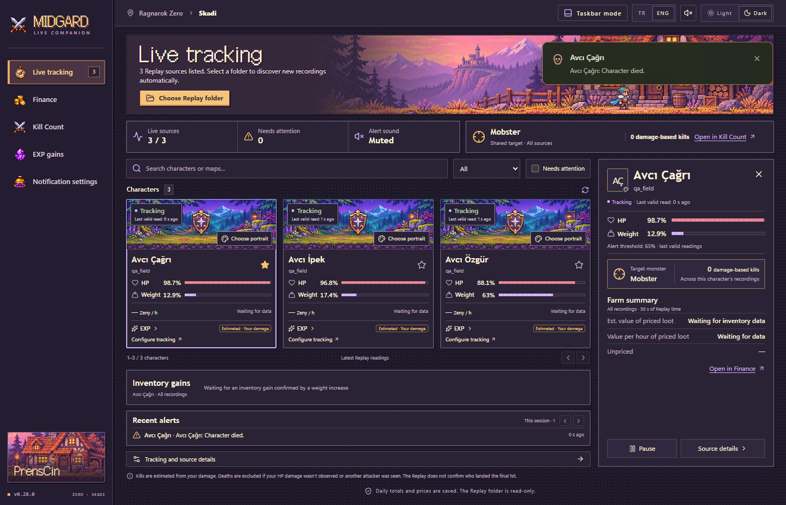
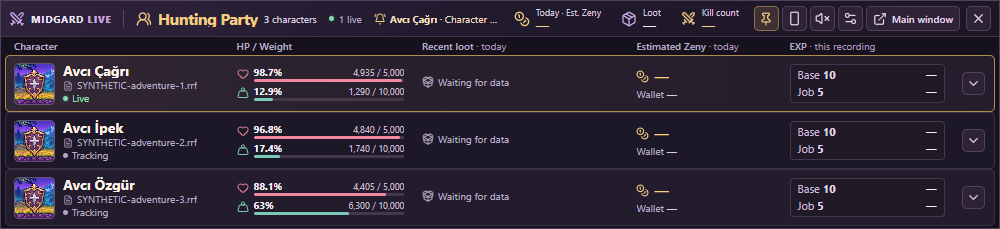

# MIDGARD LIVE · v0.28.0

**English** · [Türkçe](README.tr.md) · [Windows downloads on GitHub Releases](https://github.com/cinprens/Midgard-Live-Companion/releases)

MIDGARD LIVE is an offline Windows companion for Ragnarok Zero Global on Skadi. It follows local Replay recordings and shows your characters together while you play. The compact **Hunting Party** panel tracks HP, bag weight, daily loot, Zeny and the EXP reported by each recording.

## Get started

1. On the Windows x64 release you want, open **Assets**, download the file ending in `-Portable.exe`, and run it. Close any older instance before opening a new build.
2. To switch from Turkish to English, click **ENG** beside **Görev çubuğu modu** in the main window. **TR** switches back. The current page, alerts and compact panel change immediately. MIDGARD remembers your choice the next time it starts.
3. In the game, start a Replay recording for each character you want to follow. In MIDGARD, open **Live tracking** → **Choose Replay folder** and select the folder where the game writes its `.rrf` files. Three characters recording to the same folder appear as three separate rows.



## Use the compact Hunting Party panel

Click **Taskbar mode** in the main window. Drag the header to move the panel, use the pin to keep it above other windows, and use the orientation button to switch between horizontal and vertical layouts.

| What you see | How to read it |
| --- | --- |
| Party header | The header shows the party’s totals for today. Click a character to see that character’s totals and details. Click again to return to the party totals. |
| Character row | See the recording, data status, HP and bag weight. The three most recent distinct loot types show how many of each the character collected today. |
| Zeny | **Estimated Zeny** values the day’s collected loot using the unit prices entered in **Finance**. **Wallet** shows the latest balance read from the Replay. |
| EXP and kills | Base and Job EXP use supported Replay readings. The kill count is an estimate based on recorded damage. Missing evidence is shown as unavailable. |



Use **Main window** or **Esc** to return to the full app. The **×** button closes MIDGARD.

## Alerts, Finance and EXP

- In **Notification settings**, set the sound and scene duration for items, monster deaths, bag weight, map changes and character deaths. A scene can stay on screen for 1–60 seconds. The default is 5 seconds.
- Under **Card and costume sounds**, choose a default sound for each category or give a particular card or costume its own sound. Use **Test** to hear your selection. A step-by-step guide is available at the bottom of the settings page.
- **Finance** lists card and costume gains separately. **EXP gains** shows supported personal EXP changes and can compare compatible recordings. An unavailable EXP reading stays unknown.

## Data and offline use

The Windows app processes Replays, preferences, audio and character data on your computer. It reads the game’s Replay folder without writing to it. The catalog, EXP table, interface art and built-in loot chime ship with the application. The first launch creates a local SQLite profile. Gameplay tracking and language switching work offline.

| Data | Available sources |
| --- | --- |
| Cards, costumes and monsters | The bundled community catalog contains IDs and names for **324 cards**, **1,413 costumes** and **489 monsters**. You can search for alert targets offline on first launch. The catalog describes names and IDs. Current Skadi drops and drop rates require separate evidence. [Bundled name list](src/data/public-game-names.json) · [RagnaDex source](https://ragnadex.com/en/api/) |
| Names from your installation | Selecting the game’s Replay folder allows MIDGARD to read `System/iteminfo_enUS.lub` and `System/itemInfo_data.lub` from the same installation when available. Monster names can also come from the Replay or an installed `Ragnarok Calculator` catalog on the desktop. |
| Loot and kills | Observations come from the Replay. Supported item types and costume slots help identify pickups. Unresolved names can appear as numeric IDs. |

To take your own local name list to another computer, run the following from the source project. Replace the Replay path with your own. The optional second path adds monster names from your local calculator.

```powershell
npm.cmd run catalog:local -- "C:\Gravity\RagnarokZero\Replay" "$([Environment]::GetFolderPath('Desktop'))\Ragnarok Calculator"
```

The command writes `game-names.local.json` to the project root. Source builds load it there. For a Portable build, place it next to the executable. Git ignores this local file. It contains names, categories and numeric IDs.

If the Mobster sound is available in your installed copy of the game, MIDGARD can read it locally. The tests use synthetic recordings and one documented LATAM sample. [Test fixture source](tests/fixtures/README.md)

## Run from source

Use Windows x64, Node.js 24 and npm. Run these commands in the project folder.

```powershell
npm.cmd ci
npm.cmd run build
npm.cmd start
```

The initial setup downloads the project dependencies and Electron. For development with live interface updates, run `npm.cmd run dev`.

## Test and build for Windows

```powershell
npm.cmd test
npm.cmd run package:win
```

Windows packages are written to `release/`. After building, run `npm.cmd run test:rare-drop:desktop` to exercise notification scenes with sample data. After packaging, the following check opens a clean profile, searches three catalog categories and verifies network blocking and startup connection logs.

```powershell
node scripts/verify-offline-desktop.mjs
```

## License and credits

The MIDGARD LIVE source code is licensed under MIT. The bundled dependencies, font, catalog and sample Replay have their own terms and attributions. [MIT license](LICENSE) · [Third-party notices](THIRD_PARTY_NOTICES.md)

## Sponsor

[](https://github.com/sponsors/cinprens)

If you find this project useful, consider sponsoring on GitHub to help keep it maintained.

| Tier | Price | Description |
| --- | --- | --- |
|  *Poring Tier* | **$1/month** | Light support tier. Adds a bit of charm with fun Poring-style content. Small, cute, and appreciated. |
|  **Drops Tier** | **$3/month** | Monster drop visuals and loot-inspired additions. A little flair goes a long way. |
|  ***Poporing Tier*** | **$7/month** | For those who want to brighten things up with wobbly charm. Slightly more playful. |

> Thanks to every supporter who helps keep this alive. Even small porings matter.

| Tier | Price | Description |
| --- | --- | --- |
|  **Angeling** | **$50 one-time** | Holy aura, pure bounce, golden heart. |
|  **Ghostring** | **$100 one-time** | Ethereal vibes, phase-through energy, the cutest haunting. |
|  **Deviling** | **$250 one-time** | Mischievous shadows, pink chaos, the master of cursed fun. |

---

## Contribution

Issues and PRs are welcome.

If you want to support maintenance directly:

[GitHub Sponsors](https://github.com/sponsors/cinprens)

<details>
<summary>Earlier release notes (v0.22.0 and older)</summary>

These notes describe the behavior and verification of each release at the time it shipped.

### v0.22.0 · Notification center

Quick Add could find an item or monster by name, accept its numeric ID, or accept a map ID. Clicking a suggestion or pressing Enter on a single match enabled the rule. Monster selections were shared with hunt targets.

Finance gained an action to create an alert for the selected item. Expanding a rule in the notification center opened its targets and sound settings. Character-specific preferences had their own section.

### v0.21.1 · Startup fix

The window appeared immediately and stayed responsive while the app prepared large archives. It showed the actual preparation stages, opened the main view in the same window, and displayed an explanation on failure. Daily summaries and prices survived the upgrade.

All 1,043 tests passed, together with 32/32 startup-screen checks, 10/10 checks on a copy of real records, and 40/40 on the Portable executable. With a large archive copy, the window appeared in 345 ms and the main view opened after about 95 seconds. Startup also completed with the original user profile. The main window was visible, daily totals and prices were intact, and the 1.29 MB active database passed its integrity check.

### v0.21.0 · Daily summaries

The app began storing daily monster counts and item quantities per character, daily EXP, and prices. Individual kill and loot timestamps, event history, and detailed hunt analytics were retired. Folder tracking and live notifications continued.

The migration verified daily totals before clearing old event details and compacting the active database. On a test copy of a real profile, it shrank from 1.42 GB to 1.29 MB. Older backups stayed separate and were retained. The conversion could take time on the first launch.

All 1,035 tests passed. Verification included 27/27 checks of preserved totals on a profile copy, 39/39 desktop checks in each of the source and packaged builds, 39/39 Portable checks, 25/25 package-content checks, and 30/30 capacity checks for 50 characters. The original profile stayed untouched during these tests.

With 50 characters, increasing kills from 5,000 to 50,000 for the same dates and monster types kept the database at 1.41 MB. A separate simulation of 365 days, 50 characters, and 20 monster and 40 item types per day used about 201 MB after compaction (213 MB before), including EXP, durations, and indexes. These figures cover the active database.

### v0.20.0 · Automatic Replay folder tracking

Selecting a Replay folder enabled automatic discovery of new and growing files across characters. A verified advance marked a source live. After 15 seconds without progress, the app marked it stopped and retained the last valid values. The initial scan excluded old, static files from live activity. The folder selection survived restarts.

Repeated reads and inbox polling no longer accumulated history. Fewer temporary state records were stored, and continuous EXP intervals were merged. Daily totals, prices, older archives, backups, and the existing damage and weight filters were preserved.

Verification passed 999/999 tests, 32/32 folder-flow checks each in the source and packaged builds, 38/38 Portable checks, and 25/25 package-content checks. The fixtures used generated Replays and isolated profiles. These runs did not include installation into a real game profile or a live play session.

### v0.19.2 · Weight-confirmed loot

Loot income and item alerts required an inventory addition followed by a rise in that character’s raw carried weight. Changes in capacity or weight percentage alone did not qualify. A single weight increase could not validate multiple ambiguous additions. Storage, cart, trade, and inventory refresh events were excluded. The live view showed entries awaiting weight confirmation.

Existing income and prices were retained without retroactively marking old entries as weight-confirmed. The filter could miss zero-weight items, pickups offset by simultaneous consumption, and acquisitions with incomplete evidence. Identifying the source monster required separate evidence.

Verification passed 970/970 tests, 43/43 loot-screen checks in the source and packaged builds, 21/21 Kill Count checks, and 38/38 Portable checks. Installation into a real profile and in-game validation were outside this run.

### v0.19.1 · Kills estimated from the character’s damage

Kill Count, daily and historical lists, target hunting, analytics, and Solo EXP used deaths where only the tracked character’s HP damage appeared in the last ten seconds of that monster’s life. Deaths with no qualifying damage or with another attacker were excluded. The interface labeled this an estimate because the recording did not explicitly identify the killer.

The raw archive was retained. Eligible historical Kill Count records could be filtered using attacker evidence. Old target, analytics, and EXP totals without ownership evidence stayed separate. Players upgrading to this release needed to start a new EXP measurement. The app created a SQLite backup before migrating to schema 13.

### v0.15.0 · Daily hunt journal

Kill Count gained an all-time/daily switch, a calendar, previous and next day controls, a Today shortcut, and a seven-day count strip. The monster list, search, character filter, favorites, and observation details followed the selected day. A new day began at midnight in Türkiye, and Today refreshed automatically.

Only recordings with a verified start time contributed to dated totals. Undated observations were identified separately and retained in all-time totals. The release reused existing records without rewriting them or migrating the database.

### v0.14.1 · Replay reader and storage fixes

A zero-timestamp `0x08AE` packet found in real recordings no longer stalled the reader. A new storage slot could be matched to a withdrawal. The interface displayed the last successful read separately from the file modification time. New transfer evidence generated review candidates and left old income intact. The app kept a consistent profile backup before the schema 9 migration.

Verification included 681 tests, 186/186 packaged error-screen checks, 72/72 checks on a real profile copy, and 27/27 Portable checks. Migration of the existing profile also completed, and all three sources resumed advancing.

### v0.14.0 · Live tracking workspace

Compact character rows shared a target strip. The right-hand detail panel showed HP, weight and threshold, observed target deaths, and a read-only farm summary. Opening an item or price carried the selected character into Finance. Multiple recordings for one character were grouped in a single row. HP and map came from the selected source, which the app remembered by file path. Pagination and separate detail views limited scrolling.

Verification passed 631/631 tests, 48/48 packaged live-tracking checks, and 27/27 Portable checks, with zero renderer errors. The expanded panel was checked at 1480 × 1000, 1100 × 820, and the minimum 1100 × 720 window size.

### v0.13.0 · Kill Count workspace

Kill Count adopted the compact Finance layout with three indicators, a pinned target, monster name or ID search, a character filter, sorting, favorites, and page sizes of 25, 50, or 100 rows. The selected monster’s panel displayed recent observations and valid historical hunt intervals. The History tab queried a paginated recording or character archive directly. Preferences survived restarts. Observation counts, attributed personal kills, and possible shared targets had distinct labels.

### v0.12.0 · Finance workspace

Finance gained a compact summary, item name or ID search, character filtering, sorting, and 25-, 50-, or 100-row pages. Favorites, unpriced items, and hidden items had dedicated tabs. Editing a unit price in the detail panel updated it across characters, with an option to move on to the next missing price. Viewing preferences survived restarts. Search and visibility settings left totals intact. An explicit price of zero remained distinct from an unknown price.

### v0.11.0 · Incremental reader

The live reader began processing bounded batches of packets instead of rereading a long file’s entire history on every change. It updated counters for new events and for events whose evidence had changed. Unknown packets were not retained individually in memory. The initial history was processed silently, with subsequent new events generating alerts.

Live reading lifted the 400,000-chunk and 128 MiB whole-file limits. Limits still applied to packet batches, startup metadata, active contexts, worker count, and memory. The reader handled replacement or truncation, incomplete tails, pauses, and reopening. Game files stayed read-only, settings and persistent counters were preserved, and Skadi protocol support remained experimental.

### v0.10.0 · Target hunt timing

The live and Kill Count screens showed the interval between the last two observations of Mobster or another target, the average interval, elapsed Replay time since the last observation, and target count. All selected Replay sources contributed automatically. Target selection in Kill Count was shared with monster alerts, and turning off the sound left timing active. Matching observations of the same death across three sources were deduplicated where possible. Matches did not establish a server-wide kill ID.

For intervals of four and six minutes, the latest interval was six minutes and the mean was five. Unknown elapsed times or intervals crossing gaps showed a dash. When a recording stopped advancing, its clock waited. The mean described past observations, without establishing a respawn timer.

EXP sections and EXP or level alerts were disabled in this release. Earlier EXP records, Finance, inventory, Kill Count, and sound preferences were retained. For a Portable upgrade, the previous app needed to be closed first. Historical verification also covered party EXP in v0.9.0 and kill EXP in v0.8.0. The original v0.10.0 checkout also ran its own `scripts/target-hunt-ui-qa.mjs` check.

```powershell
npm.cmd test
npm.cmd run build
```

### v0.7.2 · Sounds and appearance

Old Blue Box (item 603) gained an independent inventory alert and a classic gold-pickup sound preset. Glass Bead (item 746) was silent by default and accepted a custom sound. The Mobster death sound could be read from the player’s installed Ragnarok game archive. The Mobster sound button could select a GRF from another installation. Existing custom sounds kept their assignments.

The application bundled its interface artwork, including an original town illustration. The persistent Light/Dark switch applied to all screens. The promotion area showed PrensCin. The visual update retained the calculation rules in Live tracking, Finance, Kill Count, EXP, and notifications.

```powershell
npm.cmd run test:design:desktop
```

### v0.7.0 · Replay EXP and monster observations

Live cards automatically loaded Base and Job levels. A supported starting class selected the corresponding Job EXP table while retaining earlier manual choices. The compact EXP summary showed both levels and separate Base and Job EXP per hour. Progress, last gain, and settings were available in the expandable details. Reopening or rereading the initial file history did not add gains a second time.

The navigation at this point contained Live tracking, Finance, Kill Count, and Notification settings. Local name mappings and stored Finance and Kill Count data survived removal of the game database screen.

This version used only Replay data. In three real Skadi recordings, the reader found class and level information but no supported packets for current EXP or gains. The hourly fields showed that EXP data was pending. After an initial balance, a subsequent supported personal gain or balance change was needed for a rate. A Job level decrease did not establish the character’s new class.

Selected-monster death alerts used Mobster as the initial selection and played only for new confirmed death observations. They supported custom sounds, preview, individual toggles, and global mute. The alert identified an observed death without identifying the killer.

Kill Count provided two main indicators, a filter based on the tracked characters, monster name search, and an automatic monster list. SQLite stored observations by character, Monster ID, Replay session, and time. Rereading the same life cycle or restarting did not duplicate it. Hourly rates used the union of overlapping Replay intervals. Indexed summary tables supplied the totals.

Damage, disappearance, or a single observed attacker was insufficient to confirm a personal kill. Without a verified killer field, a death remained unattributed and personal totals and rates displayed a dash. Shared deaths were also uncertain without a matchable identity across recordings.

Monster names were resolved locally by ID. If available, the app read the saved catalog from the desktop Ragnarok Calculator installation’s `Veriler/ragnarok.sqlite`, with its installed `catalog.json` as fallback. Only ID and name mappings were loaded into memory. Calculator prices, personal records, and database files stayed on the player’s computer.

```powershell
npm.cmd test
npm.cmd run build
npm.cmd run test:kill:desktop
npm.cmd run test:monster:desktop
npm.cmd run test:exp:auto:desktop
npm.cmd run test:desktop
npm.cmd run test:live:desktop
npm.cmd run package:win
```

### v0.5.0 · Automatic Finance

Finance began recording reliably decoded inventory additions. Replay events supplied quantities, per-character totals, estimated value, and value per hour. The player entered the shared unit price. Prices were saved automatically, and changes revalued existing automatic sessions. The interface listed items lacking prices. The same price controls appeared in the farm section of live character cards.

Manual quantity entry, session management, sales, expenses, and transfer forms were removed. Legacy v0.4 ledger data remained separate. Initial inventory, ground items, and identifiable inventory refreshes, trades, and storage transfers were excluded from new gains. Decoded additions with an unknown source were labeled as items received. Confirming a monster drop or sale profit needed more evidence. Missing observations displayed a waiting state. Missing prices stayed unknown, while an explicit zero counted as zero.

The local catalog took priority. The app could read the installed game’s static name table from `System/iteminfo_enUS.lub` beside the selected Replay installation. It read this as data, without executing Lua or writing to the client. Only an observed item’s name was saved as recording metadata.

Duration came from advancing Replay time, merging overlaps across characters. With a reliable starting context, earlier additions inside a recording could be reconstructed separately from the character’s initial inventory. Restarting preserved sessions and prices and did not double-count events. An inventory decrease alone did not establish negative income.

Real Skadi recordings supplied readable inventory structures and addition packets. Counts had not been independently reconciled against the game screen, so protocol compatibility remained experimental. EXP tracking, multiple characters, HP, weight, and sound settings continued to work.

```powershell
npm.cmd test
npm.cmd run build
npm.cmd run test:desktop
npm.cmd run test:live:desktop
npm.cmd run package:win
```

### v0.4.0 · Local Finance ledger, EXP, and data import

This version of the Electron/React app introduced the manual Finance workflow later replaced in v0.5.0. The Finance ledger and normalized EXP and inventory observations were stored locally in `midgard-live.sqlite`. The previous `midgard-replay.sqlite` archive stayed untouched. Raw Replays and game sounds were not copied. Character tracking, HP, weight, file bindings, and sound preferences were preserved.

- **EXP.** Two hundred official numeric rows carried a source and date. Coverage included Base and Novice, First, and Second Job tables, Second Job above 50, calibration, 5-, 15-, and 60-minute gains, hourly rates, and ETA. Because the official table’s level direction was ambiguous, the target-level interpretation was labeled as an inference and cross-checked against calculator totals.
- **Finance.** The ledger supported shared and character-specific prices, income, sales, expenses, transfers, open or paused or closed sessions, daily through all-time views, and optional revaluation. Sales reduced remaining inventory value. Overlapping character intervals contributed once to elapsed time.
- **Offline game data.** JSON and CSV imports included source, license, and version. Outside the official EXP facts, data required a permissioned user-supplied pack. The app supported offline search and source versioning.
- **Notifications.** Character-specific settings covered Base and Job progress, the 90% threshold, item value thresholds, hourly targets, and stalled EXP. EXP alerts that relied on unverified Skadi data were initially off.

The three available real Skadi examples contained no supported EXP packets. The interface waited for supported data or calibration. Inventory additions went to a review inbox for classification before they counted as income. Automatic expense and item-removal classification still needed verification, so manual records were available.

The v0.4.0 and v0.3.0 development packages used these commands:

```powershell
npm.cmd install
node .\node_modules\electron\install.js
npm.cmd test
npm.cmd run build
npm.cmd start
npm.cmd run package:win
```

### v0.3.0 · Live-only desktop companion

This Turkish, offline release for 64-bit Windows 10/11 tracked selected `.rrf` files independently. Live events, statistics, notifications, and snapshots stayed in memory until the app closed. Notification preferences, source paths, manual character names, and sound paths were saved in `live-preferences.json`. The old SQLite archive was left unopened. Archiving, import, export, and backup were unavailable in this version.

Visual and audio alerts covered death, inventory weight (65% by default), selected cards, entry into a city map, and level gains. Each alert accepted a custom WAV, MP3, or OGG file. The level-up sound could also be read from the player’s Ragnarok archive. The first read was silent. Remembered sources resumed at startup, while starting a Replay recording remained an action in the game.

Synthetic packet and file-growth tests covered these behaviors. End-to-end verification of every alert type against live Skadi gameplay remained outstanding. The main process used no SQLite in this release. The existing application ID preserved the earlier archive’s location.

### v0.2.1 · Replay archive and farm statistics

This earlier offline desktop tool for 64-bit Windows 10/11 inspected completed Replays, compared observations, and exported archive data without a cloud account. It read files locally and left the game client, memory, network traffic, and game files alone.

**Compatibility.** Three growing Skadi recordings were used to check Turkish names, map, file progress, and a limited set of item observations. This established partial RRF v5 container and packet support. Kill and drop counts still needed independent in-game validation. Monster deaths, confirmed personal kills, and estimated personal kills were displayed separately. Unsupported EXP and drops stayed unknown. Labeled demo data was excluded from real persistent statistics.

**Multiple characters.** Explicitly selected files were independent streams with separate position, revision, status, diagnostics, and temporary summaries. Worker and buffer budgets limited concurrent work, with other files queued fairly. There was no fixed one-, three-, or five-character limit. Players could pause, resume, stop, or remove streams without deleting source files. Recorded identities were matched automatically where available. Manual grouping did not establish ownership of a kill or damage.

At the time, file reading was incremental but analysis reparsed size-limited snapshots. An idle file did not establish that a recording had ended. Character comparisons displayed observed deaths, personal-kill certainty, damage, and supported EXP and drop information separately. Uncertain overlaps across recordings were shown as possible duplicates with their reasons.

**Item observations.** The reader distinguished appearance on the ground from a successful inventory-add notification, carrying the item ID and quantity and excluding failed responses. Refining or reforming an existing item could also emit a notification, leaving the net gain and monster source uncertain. The archive item CSV exported these observations by character and Item ID. Live detail lists were bounded while totals were retained. Full item detail was available from the persistent archive.

**Running the historical build.** Node.js 24 LTS and npm were required. The dependency and Electron setup needed internet on first installation or when repairing missing Electron files. Routine packaged analysis worked offline.

```powershell
npm.cmd install
node .\node_modules\electron\install.js
npm.cmd run dev
```

To run the compiled app:

```powershell
npm.cmd run build
npm.cmd start
```

To preview the web interface:

```powershell
npm.cmd run dev:web
```

Desktop file selection, SQLite, and folder management required the desktop application.

**Archive workflow.** The user selected completed `.rrf` files for read-only import. The library showed format, version, analysis state, and diagnostics for damaged or unsupported files. Overview, monster tables, and farm sessions compared observed results and labeled personal-kill certainty. Selecting a folder listed its Replays, and manual scanning operated on that folder. JSON exported archive summaries and normalized events. CSV exported Replay and session summaries. An application command created a database backup.

Automatic discovery stayed disabled in v0.2.1 pending validation of the relevant Gravity rules. Manual source selection and folder scanning remained available. File observation did not restart automatically at launch.

**Local data and duplicates.** SQLite lived in the application data directory shown in Settings. The backup feature used SQLite’s backup API so the backup included changes in an active WAL database. SHA-256 prevented a renamed copy of the same file from being imported twice. For overlapping sessions with matching identity, character name, and start time, the later Replay was excluded from totals. This conservative rule could also exclude unique events. Without reliable identity or timestamps, full event-level deduplication was uncertain. An undated recording displayed the labeled import date and stayed out of daily death totals.

**Testing and packaging.** The per-file limit was 128 MiB. Analysis waited for stable size and modification time and ran in a separate worker. Windows x64 Setup and Portable builds were written under `release/` without code signing. The application ID and data directory preserved existing MIDGARD REPLAY archives through database upgrades.

```powershell
npm.cmd test
npm.cmd run build
npm.cmd run test:desktop
npm.cmd run test:live:desktop
npm.cmd run package:win
```

**Technology and limits.** The stack used React, strict TypeScript, Vite, Tailwind CSS, Apache ECharts, Electron, and SQLite through `node:sqlite`. The available Node.js toolchain could build Windows packages. The development machine lacked Rust, Cargo, Visual C++ Build Tools, and the Windows SDK for the proposed Tauri 2 implementation. Electron increased the package size and avoided those build prerequisites.

The release still needed wider Skadi compatibility testing, particularly around growing files, header updates, and client shutdown. Worker and buffer budgets were independent of the number of selected records. Monster IDs across clients did not guarantee a shared server entity. Unsupported packets produced diagnostics, and unknown EXP, drops, and party kills stayed unknown. Scope excluded 3D playback, advanced map visualization, cloud sync, community statistics, game automation, and live network capture.

</details>
