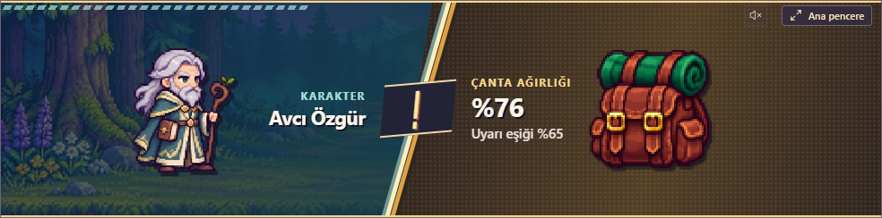

# MIDGARD LIVE · v0.28.0

[English](README.md) · **Türkçe** · [GitHub Releases üzerinden Windows sürümleri](https://github.com/cinprens/Midgard-Live-Companion/releases)

Ragnarok Zero Global / Skadi için Windows masaüstü takip aracı. Birden fazla karakterin Replay kaydını birlikte izler. Görev çubuğu modunda her karakterin son ganimetlerini, gün içindeki adetlerini, çanta ağırlığını ve Replay’de görülen Zeny hareketlerini gösterir.

Taşınabilir Windows uygulaması tamamen çevrimdışı çalışır. Katalog uygulamanın içinde gelir. Replay, ayarlar, sesler ve karakter kayıtları bilgisayarda işlenir. Çalışma sırasında dış API bağlantıları kapalıdır.



## İndirme ve dil seçimi

GitHub Releases sayfasından kullanmak istediğin Windows x64 sürümünü aç. **Assets** altında adı `-Portable.exe` ile biten dosyayı indir ve çalıştır. Yeni sürümü açmadan önce eski uygulamayı kapat.

Ana pencerenin üstünde **Görev çubuğu modu** düğmesinin yanındaki **ENG** ile İngilizceye, **TR** ile Türkçeye geçebilirsin. Ekran, bildirimler ve Av Ekibi paneli anında dil değiştirir. Seçimin sonraki açılışta hatırlanır.

## Oyunda kullanım

1. Oyunda Replay kaydını başlat. MIDGARD LIVE’da **Canlı takip** bölümüne gir ve oyunun **Replay** klasörünü seç.
2. **Görev çubuğu modu** ile karakterlerini aynı şeritte takip et. **Bildirim ayarları** bölümünde eşya, yaratık ölümü, çanta ağırlığı, harita değişimi ve karakter ölümü için sahne süresini ayrı ayrı seçebilirsin.
3. **Kart ve kostüm sesleri** bölümünden genel bir ses veya belirli bir eşya için özel bir ses seç. Sahne süreleri 1–60 saniye, başlangıç değeri 5 saniyedir.

Av Ekibi panelinin başlığını sürükleyerek konumunu değiştirebilir, raptiyeyle üstte tutabilir, dikey veya yatay görünüm seçebilirsin. Başlıkta günlük ekip toplamları görünür. Bir karaktere tıklayınca başlık o karakterin değerlerini, satır da ayrıntılarını gösterir. **Tahmini Zeny**, günün ganimetlerinin Finans’taki fiyatlarla değeridir. **Cüzdan**, Replay’den son okunan bakiyedir. **Ana pencere** veya **Esc** ile tam görünüme dönebilirsin.

**Finans** kart ve kostüm kazanımlarını ayrı gösterir. **EXP Kazanımı** desteklenen Replay verilerini ve doğrulanabilen kayıt karşılaştırmalarını kullanır. Kayıtta bulunmayan değerler için uygulama eksik bilgiyi belirtir.

## Kaynaktan çalıştırma

Windows x64, Node.js 24 ve npm ile proje klasöründe çalıştır:

```powershell
npm.cmd ci
npm.cmd run build
npm.cmd start
```

İlk kurulum, bağımlılıkları ve Electron’u internetten indirir. Geliştirme sırasında canlı arayüz güncellemeleri için `npm.cmd run dev` kullanabilirsin.

## Test ve Windows paketi

```powershell
npm.cmd test
npm.cmd run package:win
```

Windows paketleri `release/` klasörüne yazılır. Derlemeden sonra bildirim sahnelerini örnek verilerle masaüstünde denemek için `npm.cmd run test:rare-drop:desktop` komutunu çalıştırabilirsin.

Paketlemeden sonra çevrimdışı çalışmayı doğrulamak için aşağıdaki komutu çalıştır. Denetim boş bir profilde üç katalog aramasını, ağ engelini ve açılıştaki bağlantı kayıtlarını kontrol eder.

```powershell
node scripts/verify-offline-desktop.mjs
```

## Veriler

Kaynak paketinde EXP tablosu, arayüz görselleri, yerleşik ses ve test verileri bulunur. Kullanıcının SQLite profili ilk çalıştırmada oluşturulur.

| Bilgi | Yeni kurulumda nereden gelir? |
| --- | --- |
| Kart, kostüm ve canavar adları | Hazır gelen topluluk listesinde 324 kart, 1.413 kostüm ve 489 canavarın ID’si ve adı bulunur. Bildirim hedeflerini ilk açılışta çevrimdışı arayabilirsin. Bu liste Skadi’de hangi eşyaların şu anda düştüğünü veya düşme oranlarını göstermez. [Ad listesi](src/data/public-game-names.json) · [RagnaDex veri kaynağı](https://ragnadex.com/en/api/) |
| Kurulu oyundaki adlar | Oyunun `Replay` klasörünü seçtiğinde MIDGARD LIVE aynı kurulumdaki `System/iteminfo_enUS.lub` ve `System/itemInfo_data.lub` dosyalarını okur. Canavarlar için Replay’de görülen adlar ve varsa masaüstündeki `Ragnarok Calculator` kataloğu da kullanılabilir. |
| Gerçek ganimet ve kesimler | Ganimet ve kesimler Replay’den takip edilir. Desteklenen paketlerdeki eşya türü ve kostüm yuvası düşüşü tanımaya yardım eder. Ad çözülemezse kimlik numarası gösterilebilir. |

Kendi kurulumundaki kart, kostüm ve canavar adlarını başka bir bilgisayara taşımak için aşağıdaki örnekteki klasör yollarını kendi kurulumuna göre düzenle. İkinci yol isteğe bağlıdır ve canavar adlarını ekler.

```powershell
npm.cmd run catalog:local -- "C:\Gravity\RagnarokZero\Replay" "$([Environment]::GetFolderPath('Desktop'))\Ragnarok Calculator"
```

Komut proje köküne `game-names.local.json` yazar. Kaynaktan çalıştırdığında uygulama bu dosyayı bulunduğu yerden okur. Taşınabilir sürüm için dosyayı `Portable.exe` ile aynı klasöre koy. Git bu yerel kopyayı dışarıda tutar. Dosya yalnızca ad, tür ve sayısal kimlik içerir.

Oyunda varsa Mobster sesi yerel kurulumdan okunabilir. Birim testleri sentetik kayıtlar ve kaynağı belgelenmiş tek bir LATAM örneği kullanır. [Test verisinin kaynağı](tests/fixtures/README.md)

## Lisans

MIDGARD LIVE kaynak kodu MIT lisanslıdır. Üçüncü taraf bileşenlerin, yazı tipinin ve örnek Replay’in kendi lisansları ve atıfları geçerlidir. [MIT lisansı](LICENSE) · [Üçüncü taraf bildirimleri](THIRD_PARTY_NOTICES.md)

## Sponsor ol

[](https://github.com/sponsors/cinprens)

Projeyi kullanıyorsan GitHub üzerinden sponsor olarak bakımına destek verebilirsin.

| Seviye | Tutar | Açıklama |
| --- | --- | --- |
|  *Poring Tier* | **$1/ay** | Poring temalı eğlenceli içerikler için küçük ve sevimli bir destek. |
|  **Drops Tier** | **$3/ay** | Canavar ganimetleri temalı görseller ve ganimetten ilham alan eklemeler. |
|  ***Poporing Tier*** | **$7/ay** | Poporing’in zıplayan neşesinden biraz daha fazlasını isteyenler için. |

> Projeyi yaşatan her destekçiye teşekkürler. En küçük Poring bile önemli.

| Seviye | Tutar | Açıklama |
| --- | --- | --- |
|  **Angeling** | **$50 tek seferlik** | Kutsal bir aura, duru bir neşe, altın bir kalp. |
|  **Ghostring** | **$100 tek seferlik** | Öte dünyadan bir esinti ve duvarların içinden geçen sevimli bir hayalet. |
|  **Deviling** | **$250 tek seferlik** | Muzip gölgeler, pembe bir kaos ve lanetli eğlencenin ustası. |

---

## Katkıda bulunma

GitHub’da hata bildirimi açabilir ve pull request gönderebilirsin.

Bakım çalışmalarına doğrudan destek verebilirsin.

[GitHub Sponsors](https://github.com/sponsors/cinprens)

<details>
<summary>Önceki sürümlerin notları (v0.22.0 ve öncesi)</summary>

Aşağıdaki davranışlar ve test sonuçları belirtilen sürümlere aittir. Eski rapor ve paket adları tarihsel referans olarak korunmuştur.

# MIDGARD LIVE · v0.22.0

Bildirim ayarlarında **Hızlı bildirim ekle** alanından eşya veya yaratığı adıyla arayabilir, sayısal ID girebilir ya da harita kimliği yazabilirsin. Bir öneriye tıklamak veya tek eşleşmede Enter’a basmak kuralı etkinleştirir. Yaratık seçimi ortak av hedefleriyle paylaşılır.

Finans’ta bir eşyayı açıp **Bu eşya için bildirim ekle** düğmesini kullanabilirsin. Bildirim merkezinde bir kuralın satırını açarak hedeflerini ve sesini düzenleyebilirsin. Karaktere özel tercihler ayrı bölümde bulunur.

Windows Portable (`release/notification-center-0.22.0/MIDGARD-LIVE-0.22.0-x64-Portable.exe`)

## v0.21.1

**Açılış düzeltildi:** Büyük kayıtlar hazırlanırken pencere hemen görünür ve yanıt vermeye devam eder. Gerçek hazırlık aşamaları gösterilir; tamamlanınca aynı pencerede ana ekran açılır. Hata varsa görünür açıklama çıkar. Günlük özetler ve fiyatlar korunur.

Portable (`release/startup-hotfix-0.21.1/MIDGARD-LIVE-0.21.1-x64-Portable.exe`) · Açılış doğrulama raporu (`QA-STARTUP-HOTFIX-0.21.1.md`)

1.043/1.043 test, başlangıç ekranında 32/32 kontrol, gerçek kayıtların deneme kopyasında 10/10 ve gerçek Portable'da 40/40 kontrol geçti. Büyük arşiv kopyasında pencere 345 ms'de görünür oldu; yaklaşık 95 saniyelik hazırlık sonrasında ana ekran açıldı.

Gerçek kullanıcı profiliyle v0.21.1 açılışı da tamamlandı: ana pencere görünür, günlük toplamlar/fiyatlar korunmuş, aktif veritabanı 1,29 MB ve bütünlük kontrolü temiz.

## v0.21.0 — Yalnız günlük özetler

**Yalnız günlük toplamlar:** Karakter/gün/yaratık kesim sayısı, karakter/gün/eşya miktarı ve günlük EXP saklanır. Fiyatlar korunur. Tek tek kesim/loot saatleri, olay geçmişi ve ayrıntılı av analizi kaldırıldı. Replay klasörü takibi ve canlı bildirimler devam eder.

**Eski kayıtlar özetlere dönüştürülür:** Günlük toplamlar doğrulandıktan sonra aktif veritabanındaki ayrıntılar temizlenir ve dosya sıkıştırılır. Gerçek profilin deneme kopyasında aktif veritabanı **1,42 GB → 1,29 MB** oldu. Eski sürüm yedekleri bu hesaba dahil değildir ve otomatik silinmez. İlk açılışta dönüşüm nedeniyle bekleme olabilir.

Portable (`release/summary-storage-0.21.0/MIDGARD-LIVE-0.21.0-x64-Portable.exe`) · Setup (`release/summary-storage-0.21.0/MIDGARD-LIVE-0.21.0-x64-Setup.exe`) · Geçiş, alan ve doğrulama (`QA-SUMMARY-STORAGE-0.21.0.md`)

Doğrulama: 1.035/1.035 test, gerçek profil kopyasında 27/27 toplam koruma kontrolü, kaynak ve paket masaüstünde ayrı ayrı 39/39, gerçek Portable'da 39/39, paket içerik kontrolü 25/25. 50 karakter kapasite denemesinde 30/30 kontrol geçti. Gerçek profil test sırasında değiştirilmedi.

50 karakterde aynı gün/türlerde 5.000 → 50.000 kesim, veritabanını 1,41 MB'tan büyütmedi. Ayrı yıllık simülasyon: 365 gün × 50 karakter × günlük 20 yaratık/40 eşya türü, EXP/süre/indexler dahil yaklaşık 201 MB (sıkıştırma öncesi 213 MB). Replay, uygulama dosyaları ve eski yedekler dahil değildir.

## v0.20.0 — Otomatik klasör takibi

**Replay klasörünü bir kez seç:** Yeni ve ilerleyen kayıtlar otomatik bulunur; tek tek dosya seçmek gerekmez. İlk tarama eski sabit dosyaları canlı saymaz. Doğrulanmış yeni veri ilerleyince **Canlı**, 15 saniye ilerleme olmayınca **Durdu** gösterilir; son doğru değerler korunur. Birden fazla karakter birlikte takip edilir. Seçilen klasör yeniden açılışta hatırlanır.

**Günlük toplamlar ve fiyatlar kalır:** Tekrarlanan okuma/inbox geçmişi durduruldu, geçici aktif durum kayıtları azaltıldı, kesintisiz EXP süreleri birleştirildi. Eski arşivler ve yedekler silinmez. Kendi hasarı ve loot ağırlığı kontrolleri korunur.

Portable (`release/folder-live-0.20.0/MIDGARD-LIVE-0.20.0-x64-Portable.exe`) · Setup (`release/folder-live-0.20.0/MIDGARD-LIVE-0.20.0-x64-Setup.exe`) · Klasör takibi ve doğrulama (`QA-FOLDER-LIVE-0.20.0.md`)

Doğrulama: 999/999 test; kaynak ve nihai paket klasör akışında ayrı ayrı 32/32; gerçek Portable 38/38; paket içerik denetimi 25/25. Üretilmiş Replay dosyaları ve ayrı profiller kullanıldı; gerçek oyun ve gerçek profile kurulum denenmedi.

## Korunan ağırlık filtresi (v0.19.2)

**Ağırlıkla doğrulanan loot:** Yeni loot gelirleri ve eşya bildirimleri için çantaya ekleme kaydından sonra aynı karakterin ham ağırlığında artış gerekir. Ağırlık yüzdesi veya taşıma kapasitesi artışı yeterli değildir. Tek artış birden fazla belirsiz eşya kaydına paylaştırılmaz; depo, cart, ticaret ve çanta yenilemeleri gelir sayılmaz. Canlı ekranda bekleyen kayıtlar “Ağırlık doğrulaması bekleniyor” diye gösterilir.

Eski gelirler ve fiyatlar korunur; eski kayıtlar geriye dönük ağırlık doğrulaması kazanmaz. Sıfır ağırlıklı, eşzamanlı tüketim nedeniyle net artış göstermeyen veya kanıtı eksik eşya alımları bu sıkı filtrede sayılmayabilir. Eşyanın hangi yaratıktan düştüğü bu kontrolle kanıtlanmaz.

Portable (`release/loot-weight-0.19.2/MIDGARD-LIVE-0.19.2-x64-Portable.exe`) · Setup (`release/loot-weight-0.19.2/MIDGARD-LIVE-0.19.2-x64-Setup.exe`) · Loot doğrulama raporu (`QA-LOOT-WEIGHT-0.19.2.md`)

Doğrulama: 970/970 test; kaynak ve paket loot ekranında 43/43; kesim ekranında 21/21; gerçek Portable 38/38. Gerçek profile kurulum ve gerçek oyun denemesi yapılmadı.

## Korunan kendi hasarı filtresi (v0.19.1)

**Kendi hasarına göre kesim:** Kill Count, günlük/geçmiş listeleri, hedef avı, av analizi ve Solo EXP artık aynı yaratığın yaşamında son 10 saniyede yalnız kendi HP hasarın görülen ölümleri kullanır. Hasarsız, başka saldırganlı ve karışık saldırılı ölümler dışarıda kalır. Arayüz “Hasarına göre kesim / Tahmini” der; açık öldüren kimliği veya %100 kişisel kill iddiası değildir.

Eski ham arşiv korunur. Kill Count geçmişindeki uygun saldırgan kanıtları süzülür; sahiplik saklamayan eski hedef/analiz/EXP toplamları yeni hesapla birleşmez. **EXP için yeni ölçüm başlat.** Şema13 geçişinden önce SQLite yedeği oluşturulur.

Portable (`release/own-damage-0.19.1/MIDGARD-LIVE-0.19.1-x64-Portable.exe`) · Setup (`release/own-damage-0.19.1/MIDGARD-LIVE-0.19.1-x64-Setup.exe`) · Hasar filtresi ve doğrulama (`QA-OWN-DAMAGE-0.19.1.md`)

## Önceki günlük av görünümü (v0.15.0)

**Günlük av günlüğü:** Kill Count içindeki **Tümü / Günlük** geçişiyle birikmiş toplam veya seçtiğin gün görüntülenir. Takvim, önceki/sonraki gün, Bugün ve yedi günlük sayı şeridi bulunur. Günlük yaratık listesi, arama, karakter filtresi, favoriler ve gözlem ayrıntıları aynı güne göre çalışır. Günler Türkiye saatine göre 00.00 sınırında ayrılır; bugün görünümü kendiliğinden yenilenir.

Başlangıç saati doğrulanabilen Replay kayıtları günlük deftere ayrılır. Tarihi doğrulanamayan gözlemler yalnız genel toplamda kalır ve ayrıca belirtilir; işlenme saati avın gerçek tarihi sayılmaz. Mevcut kayıtlar yeniden yazılmaz, yeni veritabanı geçişi gerekmez.

Portable (`release/daily-0.15.0/MIDGARD-LIVE-0.15.0-x64-Portable.exe`) · Setup (`release/daily-0.15.0/MIDGARD-LIVE-0.15.0-x64-Setup.exe`) · Günlük doğrulama raporu (`QA-KILL-DAILY-0.15.0.md`)

## v0.14.1'den korunan okuyucu ve depo onarımı

**Okuyucu ve depo onarımı:** Gerçek kayıtlardaki sıfır zamanlı 0x08AE paketi akışı durdurmaz; yeni depo slotu ve geri çekme eşleştirilir. Son başarılı okuma zamanı, dosya değişiminden ayrı gösterilir. Eski gelirler otomatik azaltılmaz; yeni transfer kanıtı inceleme adayı olur. Şema9 geçişi öncesi tutarlı profil yedeği korunur.

Portable (`release/hotfix-0.14.1/MIDGARD-LIVE-0.14.1-x64-Portable.exe`) · Setup (`release/hotfix-0.14.1/MIDGARD-LIVE-0.14.1-x64-Setup.exe`) · Doğrulama ve geri dönüş (`QA-HOTFIX-0.14.1.md`)

Son doğrulama: 681 test, son paket hata ekranı186/186, gerçek profil kopyası72/72 ve gerçek Portable27/27. Mevcut profile geçiş tamamlandı; üç kaynak yeniden ilerliyor. Ekran örnekleri (`outputs/design/hotfix-2026-11-03/README.md`).

## v0.14.0'dan korunan Canlı takip merkezi

**Canlı takip merkezi:** Kısa karakter satırları, tek ortak hedef şeridi ve seçili karakterin sağ ayrıntısı. Panelde HP, ağırlık/eşik, hedef yaratık ölüm gözlemi ve salt okunur Farm özeti birlikte gösterilir. Eşya/fiyat düzenleme seçili karakter kapsamıyla Finans'a geçer. Aynı karakterin birden fazla kaydı tek satırda gruplanır; gösterilen HP/harita seçili kaynaktan gelir. Kaynak seçimi dosya yoluyla hatırlanır. Görünüm tablo sayfalama ve ayrı ayrıntı kipleriyle kaydırma gerektirmeden düzenlenir.

Yeni dağıtım ayrı `release/live-workspace-0.14.0` klasöründedir. Portable (`release/live-workspace-0.14.0/MIDGARD-LIVE-0.14.0-x64-Portable.exe`) · Setup (`release/live-workspace-0.14.0/MIDGARD-LIVE-0.14.0-x64-Setup.exe`) · Doğrulama raporu (`QA-LIVE-WORKSPACE-0.14.0.md`). Önceki sürümler ve kişisel kayıtlar korunur.

Son doğrulama: 631/631 test, paket içi Canlı takip 48/48, gerçek Portable 27/27; renderer hatası 0. Açık panelin kaydırmasız yerleşimi 1480×1000, 1100×820 ve minimum 1100×720 pencerelerde denetlendi. Çalışan ekran görüntüleri (`outputs/design/live-ui-2026-11-02/README.md`).

## v0.13.0'dan korunan Kill Count av günlüğü

**Kill Count av günlüğü:** Finans ile aynı kompakt çalışma alanı; üç gösterge, sabitlenen hedef, yaratık adı/ID araması, karakter filtresi, sıralama, favoriler ve 25/50/100 satırlık liste. Sağ panel seçili yaratığın son gözlemlerini ve geçerli geçmiş av aralıklarını gösterir. **Geçmiş** sekmesi kayıt/karakter kapsamındaki arşivi sayfalı sorgular; ekran için RRF yeniden çözümlenmez. Görünüm tercihleri yeniden açılışta korunur. Gözlem, kişisel kill ve olası ortak hedef sayıları açıkça ayrılır.

Yeni paketler ayrı `release/kill-workspace-0.13.0` klasöründedir. Portable (`release/kill-workspace-0.13.0/MIDGARD-LIVE-0.13.0-x64-Portable.exe`) · Setup (`release/kill-workspace-0.13.0/MIDGARD-LIVE-0.13.0-x64-Setup.exe`) · Doğrulama raporu (`QA-KILL-WORKSPACE-0.13.0.md`) · Tasarım ve kapsam (`docs/KILL_COUNT_UI_PLAN_2026-11-02.md`). Önceki paketler ve kişisel kayıtlar korunur.

## v0.12.0'dan korunan Finans çalışma alanı

**Yeni Finans çalışma alanı:** Kompakt özet, eşya adı/ID araması, karakter filtresi, sıralama ve 25/50/100 satırlık sayfalama. Favoriler, Fiyat bekleyen ve Gizlenenler sekmeleriyle uzun listeler yönetilir. Sağ ayrıntı panelindeki ortak fiyat bütün karakterlere uygulanır; fiyatı kaydedip sıradaki eksik fiyata geçilebilir. Tercihler yeniden açılışta korunur. Arama, favori ve gizleme muhasebe toplamını değiştirmez; `0` ile bilinmeyen fiyat ayrı kalır.

Yeni dağıtım ayrı `release/finance-0.12.0` klasöründedir: Portable (`release/finance-0.12.0/MIDGARD-LIVE-0.12.0-x64-Portable.exe`) · Setup (`release/finance-0.12.0/MIDGARD-LIVE-0.12.0-x64-Setup.exe`). Finans doğrulama raporu (`QA-FINANCE-0.12.0.md`) · Tasarım ve kapsam (`docs/FINANCE_UI_PLAN_2026-11-02.md`). Önceki sürümler ve kişisel kayıtlar korunur.

## v0.11.0'dan korunan artımlı okuyucu

**Uzun kayıtlar için artımlı okuyucu:** Canlı takip artık dosyanın bütün geçmişini her değişimde yeniden çözmez. Kayıt sınırlı gruplar halinde okunur; gerekli paketler seçilir, yeni ve kanıtı değişen olaylar sayaçlara taşınır. Tanınmayan paketler ayrı ayrı bellekte tutulmaz. İlk geçmiş sessiz işlenir; canlı bildirimler sonraki yeni olaylardan gelir.

Canlı okuyucuda 400.000 toplam parça ve 128 MiB toplam dosya sınırı kaldırıldı; güvenli sınırlar artık paket grubu, başlangıç metaverisi ve eşzamanlı aktif bağlam içindir. Bellek bütçesi, işçi sayısı ve hata durumları korunur. Dosya yenilenmesi/kesilmesi, eksik kuyruk, duraklatma ve yeniden açılma desteklenir. Oyun dosyalarına yazılmaz; önceki ayarlar ve kalıcı sayaçlar korunur. Skadi protokolü için deneysel etiketi devam eder.

Yeni paketler ayrı `release/bridge-0.11.0` klasöründedir. Ölçüm ve doğrulama kapsamı: Artımlı okuyucu raporu (`QA-BRIDGE-0.11.0.md`). Önceki sürümler kendi klasörlerinde korunur.

## v0.10.0'dan korunan hedef av davranışı

**Asıl hedef: Mobster ve seçtiğin diğer hedefleri kaç dakikada bir gördüğün.** Canlı takip ve Kill Count'ta son iki av arasındaki süre, ortalama av aralığı, son avdan geçen Replay süresi ve hedef adedi görünür. Bütün seçili Replay kaynakları otomatik izlenir; yeni bir ölçüm veya party başlatma işlemi gerekmez.

**Kill Count → Hedefleri düzenle** bölümünden yaratıkları seç. Liste genel yaratık bildirimi listesiyle ortaktır; sesi kapatmak zamanlamayı kapatmaz. Üç kaynakta aynı ölümün eşleşen tekrarları ayıklanır; bu, kesin sunucu kill kimliği olarak sunulmaz.

Örnek: kesimler arasında 4 ve 6 dakika varsa son aralık 6, ortalama 5 dakikadır. Bilinmeyen veya kesintiyi aşan güncel süreler — görünür. Kayıt ilerlemiyorsa sayaç bekler. Bu ortalama, doğrulanmış yaratık doğum süresi değildir.

**EXP bölümleri ve EXP/seviye uyarıları kapalıdır.** Önceki EXP ayarları/kayıtları silinmez. Finans, envanter, Kill Count ve diğer ses tercihleri korunur.

Güncel paketler ayrı `release/hunt-0.10.0` dizinindedir: Portable (`release/hunt-0.10.0/MIDGARD-LIVE-0.10.0-x64-Portable.exe`) · Setup (`release/hunt-0.10.0/MIDGARD-LIVE-0.10.0-x64-Setup.exe`) · Doğrulama raporu (`QA-HUNT-0.10.0.md`). Önce eski uygulamayı kapatıp yeni Portable'ı aç. Kullanım: Hedef av zamanlaması (`docs/TARGET_HUNT.md`).

Geliştirici kontrolleri:

```powershell
npm.cmd test
npm.cmd run build
node scripts/target-hunt-ui-qa.mjs
```

Önceki paketler korunur. Arşiv kanıtları: v0.9.0 (`QA-PARTY-EXP-0.9.0.md`) · v0.8.0 (`QA-KILL-EXP-0.8.0.md`).

## Önceki sürüm · v0.7.2

**Sesler:** Old Blue Box #603 için kartlardan bağımsız yeni çanta bildirimi eklendi. `Diablo II Gold` düğmesi klasik altın toplama sesini Old Blue Box'a bağlar. Glass Bead #746 varsayılan olarak boş ve sessizdir; istenirse sonradan kendi ses dosyası seçilebilir. Mobster ölüm sesi kurulu Ragnarok oyun arşivinden salt okunur yüklenir; `Mobster sesi` düğmesi başka kurulumun GRF dosyasını seçmeye yarar. Önceden seçilmiş kişisel sesler otomatik değiştirilmez.

Son test raporu (`QA-SOUNDS-0.7.2.md`) · Ses eşleştirmeleri ve kaynaklar (`docs/SOUND-PRESETS-0.7.2.md`)

**Yeni görünüm:** Ragnarok atmosferine uygun özgün şehir illüstrasyonu, sade düğmeler ve düzenli paneller. Üst çubuktaki **Açık / Siyah** seçimi bütün ekranlara uygulanır ve yeniden açılışta hatırlanır. Tanıtım alanında yalnız **PrensCin** yazar.

Görsel dosyaları uygulamaya dahildir. Canlı takip, Finans, Kill Count, EXP ve bildirim işlemleri aynı hesaplama kurallarıyla çalışır. Tasarım ve görsel kaydı (`docs/UI-DESIGN-0.7.1.md`), tasarım doğrulaması (`QA-DESIGN-0.7.1.md`).

```powershell
npm.cmd run test:design:desktop
```

Görünüm paketleri `release/design-0.7.1`, görünüm ve yeni sesleri içeren güncel paketler `release/design-sounds-0.7.2` klasöründe hazırlanır; önceki sürüm paketleri korunur.

## v0.7.0'dan devam eden davranış

Canlı takip kartlarında **Base Lv ve Job Lv otomatik yüklenir**. Desteklenen kayıt başlangıcı sınıfından meslek EXP tablosu da otomatik seçilir; önceden yapılmış manuel tercihler korunur. EXP alanı FARM gibi küçük bir özet kullanır: seviyeler ve ayrı **Base/Job EXP/saat** değerleri görünür; ilerleme, son kazanım ve ayarlar kapalı **EXP ayrıntıları** bölümündedir. İlk dosya geçmişi yeni kazanım sayılmaz; tekrar okuma iki kez eklemez.

Sol menü yalnız **Canlı takip, Finans, Kill Count, Bildirim ayarları** içerir. Oyun veritabanı ekranı kaldırılmıştır; yerel ad eşleştirmeleri ve kayıtlı Finans/Kill Count verileri korunur.

Bu sürüm yalnız **Replay** kaynağını kullanır; ekran okuma, OCR, oyun belleği veya ağ trafiği erişimi eklenmemiştir. İncelenen üç gerçek Skadi kaydında seviye/sınıf bilgisi bulundu, fakat desteklenen güncel EXP ve kazanım paketleri bulunmadı. Bu nedenle o kayıtlarda saatlik alanlar **EXP verisi bekleniyor** gösterir. Seviye artışından, yaratık sayısından veya anlamı kanıtlanmamış başlangıç alanlarından EXP miktarı üretilmez.

Gerçek EXP miktarı/güncellemesi taşıyan desteklenen Replay akışında hesaplar otomatik ilerler. İlk mevcut EXP değeri tek başına saatlik kazanım üretmez; sonraki kişisel EXP kazanımı veya güncel durum değişimi beklenir. Meslek seviyesi düşerse kayıt başlangıcındaki sınıf otomatik olarak yeni meslek kabul edilmez. Ayrıntılar: EXP doğrulaması (`docs/EXP_VERIFICATION.md`), v0.7 test raporu (`QA-AUTO-EXP-0.7.0.md`).

Bildirim ayarlarında **Seçili yaratık ölümü** sesi bulunur; **Mobster** başlangıçta seçilidir. Yalnız yeni ve doğrulanmış ölüm gözlemleri uyarır; açılışta geçmiş seslendirilmez. Ses seçimi, deneme düğmesi, aç/kapat ve genel sessiz mod desteklenir. Bu uyarı öldüren karakterin kimliğini kanıtlamaz; kapsam ve tekrar kuralları (`docs/MONSTER_ALERTS.md`) açıktır. Finans ve Kill Count davranışı korunur.

**Ben yaratıkları keseyim, MIDGARD LIVE saysın.** Yeni **Kill Count** sayfası Finans ile aynı sade tasarımı kullanır: iki ana gösterge, takip edilen karakterlerden oluşan dinamik filtre, yaratık adına göre arama ve ince turkuaz çubuklu yaratık listesi. Miktar veya oturum girişi istenmez. Finans, EXP ve bildirim ayarları korunur.

Ölüm gözlemleri SQLite içinde karakter, Monster ID, Replay oturumu ve zaman bilgisiyle saklanır. Aynı kayıt yeniden okunduğunda veya uygulama yeniden açıldığında aynı yaşam döngüsü tekrar eklenmez. Saatlik hesap Replay zaman aralıklarından gelir; paralel karakterlerin ortak süresi bir kez kullanılır. İstatistik özetleri indeksli toplam tablolarından okunur.

**Gerçek ölüm, kesin kişisel kill demek değildir.** Hasar, kaybolma veya tek görülen saldırgan tek başına kişisel kill kanıtı değildir. Mevcut Skadi ölüm bildiriminde öldüren karakteri belirten doğrulanmış bir alan bulunmadığında olay **Atfedilemeyen ölümler** içinde kalır; kişisel toplam ve hız `—` gösterir. Kayıtlar arasında ortak sunucu olay kimliği yoksa benzersiz ortak toplam kesinmiş gibi sunulmaz. Bu sınırlar sentetik testlerle aşılmış sayılmaz.

Yaratık adları mevcut yerel katalogdan Monster ID ile bulunur. Masaüstündeki **Ragnarok Calculator** kurulumunda varsa `Veriler/ragnarok.sqlite` içindeki kaydedilmiş katalog okunur; kaydedilmiş katalog yoksa uygulamanın kurulu `catalog.json` başlangıç verisi kullanılır. Yalnızca kimlik/ad eşlemesi RAM'e alınır. Calculator fiyatları, kişisel kayıtları ve veri dosyaları değiştirilmez veya dağıtıma kopyalanmaz. Ad kataloğu Skadi ölüm aidiyetini doğrulamaz.

```powershell
npm.cmd test
npm.cmd run build
npm.cmd run test:kill:desktop
npm.cmd run test:monster:desktop
npm.cmd run test:exp:auto:desktop
npm.cmd run test:desktop
npm.cmd run test:live:desktop
npm.cmd run package:win
```

Windows çıktıları: `release/MIDGARD-LIVE-0.7.0-x64-Portable.exe` ve `release/MIDGARD-LIVE-0.7.0-x64-Setup.exe`. Önceki Kill Count doğrulama kapsamı `QA-KILL-COUNT-0.6.0.md`, yaratık sesi doğrulaması `QA-MONSTER-ALERT-0.6.1.md` raporundadır.

---

## Finans davranışı · v0.5.0'dan korunur

**Sen fiyatı gir, gerisini bana bırak.** Finans artık manuel muhasebe ekranı değildir. Güvenilir şekilde çözümlenen çanta girişleri otomatik kaydedilir; eşya miktarı, karakter toplamı, tahmini değer ve saatlik değer Replay akışından hesaplanır. Kullanıcı yalnızca ortak birim fiyatı düzenler. Fiyatlar otomatik kaydedilir; fiyat değişince mevcut bütün otomatik oturumlar yeni fiyatla anında değerlenir.

Finans ekranında toplam değer, karakter/saat özetleri, otomatik eşya listesi ve fiyat bekleyenler bulunur. Aynı sade fiyat alanları canlı karakter kartlarının **FARM** bölümünde de yer alır. Manuel miktar, oturum başlatma, muhasebe, satış, gider veya transfer formu yoktur. Eski v0.4 defter verileri veritabanında korunur; otomatik çanta toplamına dönüştürülmez.

İlk çantadaki eşyalar, yerdeki eşyalar ve kanıtlanabilen yenileme/ticaret/depo hareketleri yeni kazanım sayılmaz. Kaynağı belirlenemeyen ama gerçek ekleme miktarı çözümlenen olaylar **Çantaya gelen eşya** olarak tutulur; kesin yaratık drop'u veya satış kârı olarak sunulmaz. Güvenilir veri yoksa **Envanter verisi bekleniyor** gösterilir. Fiyatı olmayan eşya sıfır sayılmaz; `0` fiyatı gerçek sıfırdır.

Yerel katalog önceliklidir. Gerektiğinde seçilmiş Replay dosyasının yanındaki kurulu oyunun `System/iteminfo_enUS.lub` sabit ad tablosu salt okunur veri olarak çözümlenir. Lua/oyun kodu çalıştırılmaz; istemci dosyası değiştirilmez. İsimler yerel kullanılır, oyun veri dosyası dağıtıma kopyalanmaz. Yalnızca gözlenen eşyanın adı kayıt metaverisi olarak saklanır.

Süre Replay zamanındaki ilerlemeye dayanır; paralel karakterlerde ortak zaman aralıklarının birleşimi kullanılır. Güvenilir başlangıç bağlamı varsa kayıt içindeki gerçek eski kazanımlar yeniden kurulabilir; çantada zaten bulunan başlangıç yükü bu toplama katılmaz. Oturumlar ve fiyatlar kapanıştan sonra korunur; tekrar açma aynı olayları çoğaltmaz. Envanterden eksilme tek başına negatif gelir değildir.

Mevcut EXP takibi, çoklu karakterler, HP/ağırlık ve ses ayarları korunmuştur. Gerçek Skadi dosyaları üzerinde çanta yapıları ve yeni ekleme paketleri okunmuştur; oyun ekranıyla birebir adet karşılaştırması yapılmadığından genel protokol uyumluluğu hâlâ deneysel olarak etiketlidir.

Güncel belgeler: Otomatik Finans (`docs/AUTO_FARM.md`), envanter doğrulaması (`docs/INVENTORY_VERIFICATION.md`), EXP doğrulaması (`docs/EXP_VERIFICATION.md`).

```powershell
npm.cmd test
npm.cmd run build
npm.cmd run test:desktop
npm.cmd run test:live:desktop
npm.cmd run package:win
```

Windows çıktıları: `release/MIDGARD-LIVE-0.5.0-x64-Portable.exe` ve `release/MIDGARD-LIVE-0.5.0-x64-Setup.exe`.

---

## Tarihsel belge · v0.4.0

Aşağıdaki manuel Finans açıklamaları v0.4.0'a aittir; v0.5.0'da kullanıcı arayüzünden kaldırılmıştır.

Çalışan Electron/React uygulamasına EXP, çevrimdışı oyun veritabanı ve **Finans — Farm Ekonomisi** eklendi. Mevcut canlı karakter takibi, HP/ağırlık, dosya eşleştirmeleri ve ses dosyası tercihleri korunur. Belgede adı geçen Tauri, mevcut kod tabanının altyapısı değildir; çalışan Electron altyapısı değiştirilmedi.

Yeni genişletme isteği Finans geçmişini ve denetlenebilir işlem kayıtlarını açıkça istediği için v0.4.0, önceki kayıt tutmayan sürümden farklıdır: **Finans defteri ve normalleştirilmiş EXP/envanter gözlemleri `midgard-live.sqlite` içinde yerel olarak saklanır.** Eski `midgard-replay.sqlite` açılmaz veya değiştirilmez. Ham Replay dosyaları ve oyun sesleri kopyalanmaz; oyun istemcisine, belleğine veya ağ trafiğine erişilmez.

- EXP: 200 resmî sayısal satır ve satır başına kaynak/tarih; Base ve Novice/First/Second Job tabloları, Second Job 50 üzeri, kalibrasyon, 5/15/60 dakika kazanımı, saatlik hız ve ETA. Resmî tablonun seviye yönü açık olmadığından hedef-seviye yorumu destekleyici hesaplayıcı toplamlarıyla çapraz kontrol edilir ve bu çıkarım görünürdür.
- Finans: ortak/karaktere özel fiyatlar, manuel kazanım, satış, gider, transfer, açık/duraklatılmış/kapalı oturumlar, günlük/haftalık/aylık/tüm zamanlar ve fiyatların isteğe bağlı yeniden değerlemesi. Satılan eşya elde kalan değerden düşer; paralel karakterlerin saati ortak gerçek sürenin birleşimiyle hesaplanır.
- Oyun veritabanı: kaynak/lisans/sürüm bilgili JSON/CSV içe aktarma, çevrimdışı arama ve kaynak sürümleme. Üçüncü taraf site veritabanı topluca kopyalanmadı; resmî EXP olguları dışında veri için izinli kullanıcı paketi gerekir.
- Bildirimler: mevcut sesler ve test düğmeleri korunur. Karaktere özel ayarlar ve Base/Job, %90, değer eşiği, saatlik hedef, EXP durması bildirimleri eklenmiştir. Tahmini/Skadi doğrulaması bekleyen verilerle yeni EXP uyarıları varsayılan olarak kapalıdır.

**Gerçek Skadi EXP paketleri mevcut üç örnekte bulunmadı.** İlerleme sıfır veya doğrulanmış gibi gösterilmez; desteklenen veri veya kalibrasyon beklenir. Envanter bildirimleri doğrudan farm geliri değildir: sınıflandırılmamış inceleme kutusundan kullanıcı onayı gerekir. Otomatik eşya çıkarma ve gider sınıflandırması henüz doğrulanmadı; manuel kayıt kullanılabilir.

Güncel belgeler: EXP doğrulaması (`docs/EXP_VERIFICATION.md`), veritabanı ve içe aktarma (`docs/EXPANSION_DATABASE.md`), Finans modeli (`docs/FINANCE_V1.md`).

```powershell
npm.cmd install
node .\node_modules\electron\install.js
npm.cmd test
npm.cmd run build
npm.cmd start
npm.cmd run package:win
```

Windows paketleri `release/MIDGARD-LIVE-0.4.0-x64-Portable.exe` ve `release/MIDGARD-LIVE-0.4.0-x64-Setup.exe` adlarıyla hazırlanır. Kaynak kod ve testler projeyle birlikte teslim edilir.

---

## Tarihsel belge · v0.3.0

Aşağıdaki kayıt tutmama açıklamaları v0.3.0'a aittir. Yeni Finans/EXP veritabanı için yukarıdaki v0.4.0 kapsamı geçerlidir.

Windows 10/11 64-bit için Türkçe, çevrimdışı ve **yalnızca anlık yardım** uygulaması. Seçtiğiniz mevcut `.rrf` kaynaklarını birbirinden bağımsız izler; karakter durumu, EXP ve sesli bildirimleri tek ekranda sunar. Oyun istemcisine, belleğine veya ağ trafiğine erişmez; oyun dosyalarını değiştirmez.

**Oyun etkinliği kaydedilmez.** Olaylar, istatistikler, bildirimler ve analiz görüntüleri yalnızca bellektedir; uygulama kapanınca silinir. Yalnızca bildirim tercihleri, seçilen kaynak yolları, manuel karakter adları ve ses dosyası yolları `live-preferences.json` içinde hatırlanır. Eski SQLite arşivi bu sürümde açılmaz, okunmaz veya değiştirilmez. Arşiv, içe/dışa aktarma ve veri yedeği işlevleri kapalıdır.

Ölüm, ayarlanabilir ağırlık eşiği (varsayılan %65), seçili kartlar, şehir haritasına geçiş ve seviye artışı için görsel/sesli bildirim bulunur. Her bildirim için kendi WAV/MP3/OGG sesinizi veya kendi Ragnarok oyun arşivinizdeki orijinal seviye sesini seçebilirsiniz. İlk okuma sessiz başlangıçtır; geçmiş olaylar bildirim üretmez. Hatırlanan kaynaklar açılışta otomatik izlenir; uygulama oyun Replay kaydı başlatmaz.

**Skadi canlı bildirimlerinin tamamı gerçek oyun olaylarıyla doğrulanmamıştır.** Sentetik paket testleri ve dosya büyümesi kontrolü, ölüm/ağırlık/kart/şehir/seviye bildirimlerinin gerçek oyunda uçtan uca doğrulamasının yerine geçmez. Güncel kapsam ve veri sınırları: `docs/LIVE-ONLY.md`.

Kaynak projeyi çalıştırmak ve paketlemek için:

```powershell
npm.cmd install
node .\node_modules\electron\install.js
npm.cmd test
npm.cmd run build
npm.cmd start
npm.cmd run package:win
```

Paketler `release` klasörüne `MIDGARD-LIVE-0.3.0-x64-Setup.exe` ve `MIDGARD-LIVE-0.3.0-x64-Portable.exe` adlarıyla üretilir. Aynı uygulama kimliği eski arşiv dosyalarının yerinde korunması için sürdürülür; yeni ana süreç SQLite kullanmaz.

---

## Önceki sürüm belgesi · v0.2.1

**Aşağıdaki bölüm tarihsel v0.2.1 davranışını anlatır.** Arşiv, içe/dışa aktarma, yedekleme ve açılışta izlememe açıklamaları v0.3.0 için geçerli değildir. Güncel kullanım için yukarıdaki bölüm ve `docs/LIVE-ONLY.md` esas alınmalıdır.

Windows 10/11 64-bit için Türkçe, çevrimdışı `.rrf` replay inceleme ve farm istatistik uygulaması. Hesap veya bulut servisi gerektirmez. Oyun istemcisine bağlanmaz; ağ paketleri yakalamaz, oyun belleği okumaz ve oyun dosyalarını değiştirmez.

## Uyumluluk durumu

**Ragnarok Zero: Global — Skadi protokolünün tamamı doğrulanmamıştır.** v0.2.1'de kullanıcının seçtiği üç büyüyen kayıtta Türkçe adlar, harita, dosya ilerlemesi ve sınırlı eşya gözlemleri sınandı. Bu, oyun ekranıyla bağımsız kill/drop doğrulaması değildir. RRF v5 kapsayıcısı ve sınırlı paket alt kümesi desteklenir; bir dosyanın açılması bütün paketlerinin doğrulandığı anlamına gelmez. Ayrıntılar: `RRF_COMPATIBILITY.md` ve v0.2.1 notları (`docs/LIVE_0.2.1.md`).

Yaratık ölümü, kesin kişisel kill ve tahmini kişisel kill ayrı tutulur. Hasar veren son oyuncu kesin katil sayılmaz. Paketle doğrulanmayan EXP ve drop değerleri bilinmiyor olarak kalır. Demo görünümü **DEMO VERİ** etiketi taşır ve kalıcı gerçek istatistiklere eklenmez.

## MIDGARD LIVE: çoklu karakter

MIDGARD LIVE ekranı, açıkça seçtiğiniz birden fazla `.rrf` dosyasını ayrı akışlar olarak yönetir. Karakter sayısı 1, 3 veya 5 ile sınırlandırılmaz. Eş zamanlı okuma/analiz işi sayısı ve tampon bütçesi bilgisayar kaynaklarına göre sınırlandırılır; diğer kayıtlar adil işlem kuyruğunda bekler.

Her akışın okuma konumu, revizyonu, durumu, tanılaması ve geçici analiz özeti ayrıdır. Akışı duraklatabilir, sürdürebilir, durdurabilir veya listeden kaldırabilirsiniz. Bu işlemler kaynak dosyayı silmez. Kayıt karakter adı ve kimliği veriyorsa otomatik eşleştirme kullanılır; eksik kimlik için manuel karakter eşleştirmesi sunulur. Manuel eşleştirme dosyadaki oyuncu kimliğini veya kill/hasar aidiyetini uydurmaz.

**Bu bir doğrulanmış Skadi canlı çözümleyicisi değildir.** Dosya okuması konumsal ve artımlıdır; değişen içeriğin analizi boyutu sınırlandırılmış tam dosya anlık görüntülerini yeniden ayrıştırır. RRF paketlerinin gerçek zamanlı olarak güvenilir biçimde kuyruktan çözüldüğü iddia edilmez. Dosya boyutunun bir süre değişmemesi, kaydın sona erdiğini kanıtlamaz. Canlı akışlar ve istatistikleri deneysel / doğrulanmamış olarak gösterilir.

Karakter karşılaştırmasında gözlenen ölüm, kişisel kill kesinliği, hasar, destekleniyorsa EXP ve drop ayrı sunulur. Birleşik ölüm gözlemleri, benzersiz yaratık kill sayısı olarak etiketlenmez. Farklı karakter kayıtlarında aynı yaratığın görünmesi güvenilir biçimde eşleştirilemiyorsa birleşik benzersiz ölüm bilinmiyor kalır; şüpheli tekrar adayları ve gerekçeler gösterilir.

Eşya paneli, desteklenen paketlerde **yerde görülme** ile **başarılı envanter ekleme bildirimi** gözlemlerini ayrı gösterir. Item ID ve miktar okunur; başarısız cevaplar sayılmaz. Bildirim, mevcut eşyanın refine/reform sonrası yeniden gösterilmesi için de kullanılabildiğinden net yeni loot veya envanter artışı değildir. Eşyanın yaratık kökeni ve kişisel drop aidiyeti bilinmiyor kalır. Kaynak ve sınırlar: Eşya gözlemleri (`docs/ITEM_OBSERVATIONS.md`).

**Arşiv eşya CSV**, kalıcı arşivdeki gözlem dökümünü karakter ve Item ID bilgileriyle dışa aktarır; kişisel drop/kazanç raporu değildir. Geçici canlı görünümde bu aktarım kullanılmaz. Canlı kartlarda ayrıntı listeleri kaynak kullanımı için sınırlandırılır; toplam gözlem sayaçları korunur. Tam arşiv dökümü için kalıcı arşiv görünümünü kullanın.

Yeni dosyaların otomatik keşfi için klasör keşif altyapısı bulunur; Gravity uygunluk kapısı doğrulanmadığından otomatik klasör keşfi etkinleştirilemez. Seçilmiş dosyaların açıkça başlatılan deneysel gözlemi ve elle yenileme bu kapıdan ayrı tutulur. Ayrıntılı davranış ve sınırlar: MIDGARD LIVE (`docs/MIDGARD_LIVE.md`).

## Başlatma

Node.js 24 LTS ve npm gerekir. PowerShell'de proje klasöründe:

```powershell
npm.cmd install
node .\node_modules\electron\install.js
npm.cmd run dev
```

`electron/install.js`, Electron'un Windows çalışma dosyalarını indirir. Bu ortamda kurulum paketi otomatik indirmeyi çalıştırmadığı için komut açıkça verilmiştir; yalnızca ilk kaynak kurulumu veya eksik Electron dosyalarını onarma sırasında internet gerekir. Paketlenmiş uygulamanın günlük analizi internet gerektirmez.

Derlenmiş uygulamayı çalıştırmak için:

```powershell
npm.cmd run build
npm.cmd start
```

Yalnızca arayüz geliştirme önizlemesi:

```powershell
npm.cmd run dev:web
```

Tarayıcı önizlemesi masaüstü dosya seçimi, SQLite veya klasör yönetimi yerine geçmez.

## Kullanım

1. **Replay içe aktar** ile tamamlanmış `.rrf` dosyalarını seçin. Kaynak dosyalar salt okunur açılır; değiştirilmez veya silinmez.
2. Replay kütüphanesinde formatı, sürümü, analiz durumunu ve tanılama mesajlarını inceleyin. Desteklenmeyen ve bozuk dosyalar anlaşılır hata ile kaydedilir.
3. Genel bakış, yaratık tablosu ve farm oturumları üzerinden gözlenen sonuçları karşılaştırın. Kişisel kill kesinliği ayrı gösterilir.
4. Replay klasörünü seçmek mevcut `.rrf` dosyalarını listeler. Manuel tarama yalnızca seçilmiş klasörü işler.
5. JSON/CSV dışa aktarma ve veritabanı yedekleme için uygulamadaki komutları kullanın. JSON, arşiv özetlerini ve normalleştirilmiş olayları; CSV, replay/oturum özetlerini içerir.

Otomatik klasör keşfi varsayılan olarak kapalıdır. Gravity kuralları açısından uygunluk doğrulanmadığından etkinleştirme kapısı kilitlidir; bir onay kutusu bu koşulu tek başına sağlamaz. Manuel dosya seçimi ve klasör taraması kullanılabilir.

## Yerel veri ve tekrarlar

SQLite veritabanı kullanıcıya ait uygulama veri klasöründe tutulur. Tam konum Ayarlar ekranında gösterilir. Yedekleme SQLite yedekleme API'sini kullanır; açık bir WAL veritabanının yalnızca ana dosyasını kopyalamak yerine uygulamadaki yedekleme komutunu tercih edin.

SHA-256 aynı dosyanın farklı adla tekrar içe alınmasını engeller. Kimlik, karakter adı ve başlangıç zamanı eşleşen örtüşen oturumlarda sonraki replay toplamların dışında bırakılır. Bu muhafazakâr yaklaşım örtüşmeyen bölümdeki olayları da dışlayabilir. Güvenilir kimlik veya zaman olmayan kayıtlarda olay düzeyinde tekrarların bütünüyle giderildiği iddia edilmez. Kayıt tarihi bilinmiyorsa kütüphane içe aktarma tarihini açık etiketle gösterir; bu kayıt günlük ölüm toplamlarına eklenmez.

Tek dosya sınırı 128 MiB'dır. Dosyanın boyutu ve değiştirilme zamanı sabit kalana kadar beklenir. Büyük ayrıştırma işi arayüzden ayrı bir worker'da yürütülür.

## Test ve Windows paketi

```powershell
npm.cmd test
npm.cmd run build
npm.cmd run test:desktop
npm.cmd run test:live:desktop
npm.cmd run package:win
```


`release` klasörü Windows x64 kurulum ve taşınabilir paketleri için hedef klasördür. v0.2 paketleri `MIDGARD-LIVE-0.2.1-x64-Setup.exe` ve `MIDGARD-LIVE-0.2.1-x64-Portable.exe` adını kullanır. Gerçekten tamamlanan v0.2 kontrolleri `QA-LIVE.md`, önceki v0.1 sonuçları `QA.md` içinde kaydedilir. Gerçek oyun kaydı doğrulaması ile sentetik birim testleri aynı kanıt değildir.

Dağıtım paketleri kod imzası içermez. Uygulama kimliği ve veri klasörü mevcut MIDGARD REPLAY arşivlerini korumak için değiştirilmez. Veritabanı sürüm geçişleri kayıtları silmeden yapılır. Uygulama açılışında dosya gözlemi kendiliğinden yeniden başlatılmaz.

## Teknoloji kararı

React + TypeScript strict mode, Vite, Tailwind CSS, Apache ECharts, Electron ve SQLite (`node:sqlite`) kullanılır. İstenen Tauri 2 / Rust yerine Electron seçildi: geliştirme ortamında Rust, Cargo, Visual C++ Build Tools ve Windows SDK bulunmadı; mevcut Node.js ile gerçekten çalıştırılıp Windows paketi üretilebilen bir masaüstü altyapısı sağlandı. Bu tercih daha büyük uygulama paketi pahasına Rust derleme araçlarına olan ihtiyacı kaldırır.

Mimari: `ARCHITECTURE.md`. Kaynak araştırması ve paket sınırları: `RRF_COMPATIBILITY.md`. Üçüncü taraf lisansları: [THIRD_PARTY_NOTICES.md](THIRD_PARTY_NOTICES.md).

## v0.2 sınırları

- Gerçek Skadi `.rrf` örnekleriyle uyumluluk ve istatistik doğrulaması tamamlanmalıdır.
- Büyüyen gerçek Skadi kayıtlarında canlı okuma, dosya başlığı güncellemeleri ve istemci kapatma davranışı ayrıca doğrulanmalıdır.
- Dosya başına 128 MiB ve toplam işlem/tampon bütçesi sınırları vardır; kayıt adedi sınırı ile aynı şey değildir.
- Manuel karakter ataması, kayıt sahipliğini veya kişisel kill/hasar aidiyetini kanıtlamaz.
- Farklı istemcilerdeki yaratık kimliklerinin aynı sunucu varlığını temsil ettiği varsayılmaz; belirsiz birleşik benzersiz kill toplamı verilmez.
- Kapsanmayan paketler tanılama olarak raporlanır; uydurma paket şeması kullanılmaz.
- EXP, item drop ve party kill ayrıntıları yalnızca doğrulanabilir olay varsa anlamlıdır; mevcut kaynak profilindeki eksikler sıfır başarı olarak sunulmaz.
- 3D oynatma, gelişmiş harita görselleştirme, bulut eşitleme ve topluluk istatistikleri kapsam dışıdır.
- İstemciye müdahale, otomatik oyun kontrolü ve canlı ağ dinleme uygulanmaz.

</details>
